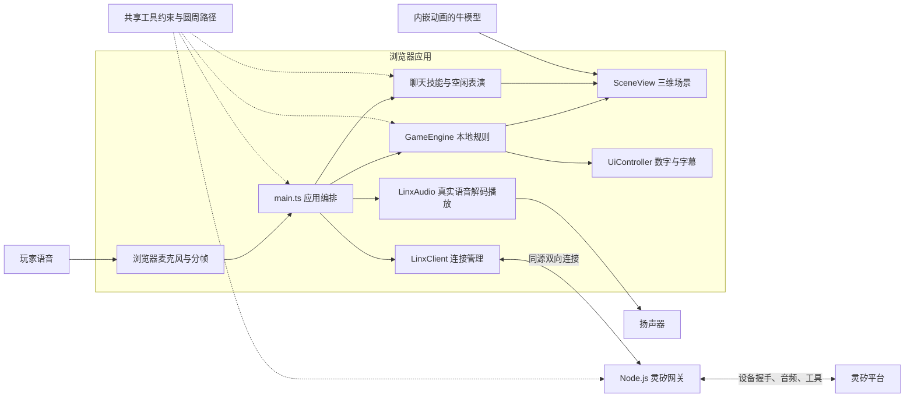
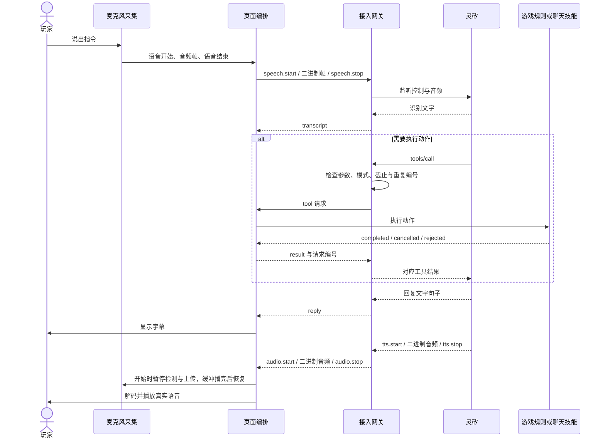

# 牛七七当前架构

本页面向维护者，说明当前代码的组成、调用链路、状态归属和运行边界；首次启动请看 [README](../README.md#本地运行)。本文按当前实现整理，不把[早期设计稿](implementation-plan.md)和[模块计划](module-plans/README.md)中的目标视为已交付能力。

## 1. 系统组成

应用由浏览器页面和 Node.js（服务端 JavaScript 运行环境）接入网关组成。灵矽提供语音识别、意图理解、工具调用和问答；浏览器执行游戏规则和动画。角色声音由灵矽合成，网关转发原始音频，页面解码播放；字幕不触发本地朗读。

前端使用 Vite（开发与构建工具）、TypeScript（带类型检查的 JavaScript）和 Three.js（浏览器三维渲染库），没有额外界面框架。页面针对手机竖屏布局；WKWebView（iOS 系统网页容器）只是后续复用方向，仓库尚无原生 iOS 外壳。

## 2. 模块职责与代码入口

| 模块 | 职责 | 实现入口 |
| --- | --- | --- |
| 应用编排 | 创建模块、路由灵矽消息、切换模式、协调语音与自动表演、处理页面生命周期 | [main.ts](../web/src/main.ts) |
| 本地规则 | 动作队列、位置、边界、苹果生命周期、碰撞、计分、疲惫与结算 | [game-engine.ts](../web/src/game/game-engine.ts)、[规则类型与默认值](../web/src/game/types.ts) |
| 圆周运动 | 两种模式共用位置与朝向采样；游戏计算圆弧接触和首次触边进度 | [共享路径](../shared/circle-motion.ts)、[circle-path.ts](../web/src/game/circle-path.ts) |
| 三维表现 | 加载模型、镜头、阴影、苹果入袋、姿态映射；`ModelRig` 管理模型动画和水平根位移 | [SceneView.ts](../web/src/scene/SceneView.ts) |
| 聊天动作 | 绕圈轨迹、真实动画片段的结束与取消、程序化兜底；不修改游戏得分 | [ChatSkillPlayer.ts](../web/src/scene/ChatSkillPlayer.ts) |
| 空闲计时 | 静默五秒后触发舞蹈，每支结束停半秒再随机续播 | [ChatIdleTimer.ts](../web/src/scene/ChatIdleTimer.ts) |
| 页面显示 | 切换聊天/游戏数字图层、展示最多一百条对话记录；不渲染操作按钮 | [UiController.ts](../web/src/ui/UiController.ts) |
| 音频输入 | 申请麦克风、分帧、语音活动检测、回复播放时暂停上传 | [PcmRecorder.ts](../web/src/audio/PcmRecorder.ts)、[pcm-worklet.js](../web/src/audio/pcm-worklet.js) |
| 语音输出 | 按下行参数解码、连续播放、取消旧任务、按实际振幅驱动嘴型 | [LinxAudio.ts](../web/src/audio/LinxAudio.ts) |
| 游戏音效 | 仅生成抓取、疲惫等短音效，不朗读角色回复 | [GameAudio.ts](../web/src/audio/GameAudio.ts) |
| 音频转发 | 过滤非播放轮次的音频，转发下行参数、状态与原始二进制帧 | [audio-relay.ts](../server/audio-relay.ts)、[共享参数](../shared/audio.ts) |
| 浏览器连接 | 申请本地会话、连接同源网关、传递控制消息与音频 | [LinxClient.ts](../web/src/linx/LinxClient.ts) |
| 接入网关 | 设备激活与绑定、上游连接、工具发现、模式与截止校验、去重、结果回传 | [server/index.ts](../server/index.ts) |
| 工具契约 | 四个工具的参数定义、动作集合、参数检查和模式限制 | [shared/tools.ts](../shared/tools.ts) |

`MockLinxAdapter` 保留为本地模拟辅助，当前页面入口创建的是 `LinxClient`，不会在连接失败后自动切换到模拟智能体。

## 3. 启动与连接链路

浏览器与网关使用 HTTP（超文本传输协议）建立会话，并使用 WebSocket（双向长连接协议）传递控制消息和音频。

1. 页面创建规则、场景、音频和连接模块，默认进入聊天模式。
2. `LinxClient` 请求 `POST /api/session`。网关读取或创建浏览器设备身份，保存到 `.linx-devices.json`，下发 `nqq_device` 会话 Cookie（浏览器自动携带的会话标识）。
3. 浏览器连接 `/api/linx`。网关校验请求来源和会话，并在当前进程内锁定设备，避免同一设备同时被两个页面占用。
4. 网关请求设备激活信息；必要时使用 `LINX_API_KEY` 绑定智能体，否则把激活码交给页面提示手动绑定。
5. 网关使用上游凭证连接灵矽，声明音频能力，响应 MCP（Model Context Protocol，模型上下文协议）的初始化和工具发现。
6. 设备 `hello` 和 `tools/list` 都完成后才发送 `ready`。页面随后申请麦克风并开始连续采集。

密钥和上游设备令牌只由网关读取。`.linx-devices.json` 保存设备身份映射，不保存本局苹果、分数或动作进度。`GET /api/config` 只返回是否配置智能体编号和声音类型，不证明连接已经就绪。

## 4. 语音、工具与结果回传

音频工作线程把输入转换为 PCM（Pulse-Code Modulation，脉冲编码调制）16kHz 单声道、16 位小端数据，每帧二十毫秒。VAD（Voice Activity Detection，语音活动检测）根据音量判定语音开始，连续静音约七百毫秒后结束当前轮次；工作线程输出静音，不把麦克风原声回放。

网关把识别文字转为 `transcript`，回复句子文字转为 `reply`，同时转发 `hello.audio_params`、语音状态和原始二进制帧。页面使用 `opus-decoder` 的 WebAssembly（浏览器可运行的二进制模块）解码 Opus（音频压缩编码格式），也支持单声道十六位小端 PCM。解码器采样率取服务端下行参数，不沿用麦克风参数。

播放开始时暂停麦克风检测与上传，以避免把回复当作用户输入；正常结束等所有待解码帧与已调度音源排空后再恢复。打断、断线或后台切换立即停音，并通过取消代次阻止旧异步任务重新播放。当前不支持在回复播放期间靠本地麦克风抢话；支持上游打断状态和开始新输入时取消旧语音。嘴型使用输出振幅，不代表逐音素嘴型。系统限制自动播放时需轻触页面解锁音频。

网关保留游戏中的文字提交协议用于开发联调，但页面没有文字输入入口；普通聊天和动作指令由真实语音进入灵矽，不在页面使用关键词规则代替意图理解。

## 5. 状态与权威边界

### 模式和本局截止

默认模式是 `chat`。灵矽调用 `start_apple_game` 后，网关创建本局编号 `roundId` 和三分钟截止时间，并发送 `round`。页面把网关剩余时长转换为本地截止时间，开始本地游戏。退出工具或到点结算后返回聊天模式。

网关负责校验模式、设备占用和本局截止，并在到点时发送 `finished`；浏览器 `GameEngine` 负责 `ready`、`running`、`finished` 三个游戏阶段，以及准确的苹果生命周期、位置、碰撞和分数。网页声音和模型动画都不能改变计分或延长游戏。当前没有服务端计分与防作弊保障。

公共规则摘要：每局三分钟、苹果寿命一分钟、同时最多两颗、抓取或过期后一秒补位。默认值的权威入口是[规则配置](../web/src/game/types.ts)，完整机制见[游戏规则文档](../web/src/game/README.md)。

### 位置、身体动画与聊天表演

- 游戏普通移动按照“转向 → 移动 → 回正”执行。动画按规则阶段采样；正常移动使用 `Running`，疲惫使用 `Walking`，两者实际移动速度沿用规则配置。
- 两种模式的 `spin` 共用半径一米、默认约 4.2 秒的圆周采样，身体朝向路径切线并播放 `Walking`。聊天绕圈由技能节点承载；游戏绕圈的位置由规则引擎推进，圆弧上的真实接触负责计分。游戏中途停止保留位置，触边提前结束；聊天技能停止时复位技能节点。
- `ModelRig` 锁定动画的水平根位移，避免动画自行把角色带离碰撞坐标；游戏转身去除骨盆动画的重复水平旋转，由外层轨迹控制最终朝向。
- 聊天跳舞在四个候选片段中随机选择，后空翻使用 `Backflip`，以混合器结束事件回传完成；游戏后空翻按本地规则阶段进度采样。模型不可用时保留程序化表现兜底。
- 聊天双方结束说话后静默五秒，开始连续随机表演，每支舞结束停半秒再重新随机选择；用户开口或指令到达停止自动表演，对话结束后重新等待五秒，主动技能优先。自动表演不创建工具请求，不回传伪造的执行结果。

运行资源是 `assets/niu_qi_qi.glb`。GLB（三维模型二进制传输格式）内部包含骨骼和十九个动画片段；完整动作、选择规则和表情限制见[模型动作清单](model-assets.md)。

## 6. 重复请求、超时与生命周期

| 情况 | 当前处理 |
| --- | --- |
| 同一连接重复工具编号 | 网关保留待执行记录和已完成结果；执行中不重复下发，完成后重发缓存结果 |
| 非法参数或模式不允许 | 网关按共享契约拒绝；页面也检查动作的模式限制 |
| 游戏动作排队 | 当前动作和等待队列合计最多两个请求；越界步数和满队列返回拒绝 |
| 聊天动作重叠 | 主动动作执行中拒绝新的主动技能；自动表演可被主动指令打断 |
| 工具超时 | 聊天跳舞十二秒，游戏动作十秒，其他工具六秒；网关返回失败并通知页面取消，不自动重放 |
| 初始化超时 | 握手与工具发现四十秒未就绪则关闭连接并返回错误 |
| 上游断线或设备错误 | 网关清理当前连接、定时器和设备锁；页面停止采集并取消聊天动作，提示刷新重试 |
| 页面进入后台 | 停止当前游戏动作和聊天技能、释放麦克风、停止声音并关闭连接 |
| 页面重新可见 | 重新建立连接；当前没有跨连接续局协议 |
| 自然结算后继续聊天 | 返回聊天视图并保留采集；本地结算提示仅显示字幕，灵矽角色回复通过真实音频播放 |
| 刷新或关闭页面 | 本局状态只在页面内存中，不持久化分数，也不能恢复上一局 |

去重与设备锁都只在单个网关进程内生效，不是跨实例的分布式保证。网关没有账号登录或对外发布所需的完整访问控制，现有同源检查和设备会话用于本地接入。

## 7. 两种运行方式

| 方式 | 页面来源 | 网关来源 | 配置与数据 |
| --- | --- | --- | --- |
| 开发：`npm run dev` | Vite 开发服务器，通常为本机 5173 端口 | [Vite 插件](../vite.config.ts)挂载到同一服务 | 仓库根目录 `.env` 和 `.linx-devices.json` |
| 构建后：`npm run build` → `npm run server` | `dist/` 内的静态页面和模型 | 同一个 Node.js 服务，默认本机 8787 端口 | 根目录读取配置与设备映射，`PORT` 控制端口 |

两种方式都只监听 `127.0.0.1`，前端使用同源 `/api/` 路径。手机联调需提供可访问的 HTTPS（加密网页传输协议）入口，转发页面、接口和双向连接。单独发布前端目录不能替代设备网关。具体步骤见 [README 运行说明](../README.md#本地运行)。

## 8. 验证与未完成项

- [规则测试](../web/src/game/game-engine.test.ts)和[圆周路径测试](../tests/game-spin.test.ts)验证游戏事实、时间边界、停止、触边与抓取；不依赖灵矽判断结果。
- [聊天技能测试](../tests/chat-skills.test.ts)读取实际模型、比较骨骼姿态，验证片段完成、取消、随机候选和优先关系；图片解码不在该测试范围内。
- [语音测试](../tests/linx-audio.test.ts)使用真实 Opus 解码器和可控扬声器验证采样、调度、排空与取消，并串联网关音频转发和客户端收包；不代表音色听感验收。
- [浏览器测试](../tests/browser.mjs)使用模拟网关验证页面契约和工具链路，不代表真实账号、麦克风或真机通过。
- 真实灵矽已验证设备握手和工具发现；完整语音驱动游戏、长舞蹈调用和手机录放音仍需实际验收。具体证据和环境限制见[验证记录](verification.md)。

后续原生 iOS 外壳、服务端计分和公开部署能力不作为当前已实现架构的一部分。真实音色播放代码已接入，控制台换音色后的实际听感与 iPhone 录放音仍需联调验收。
