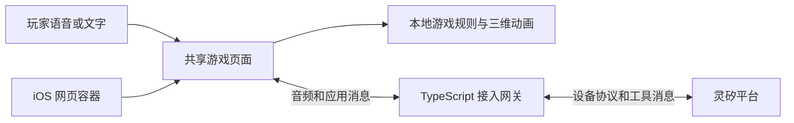
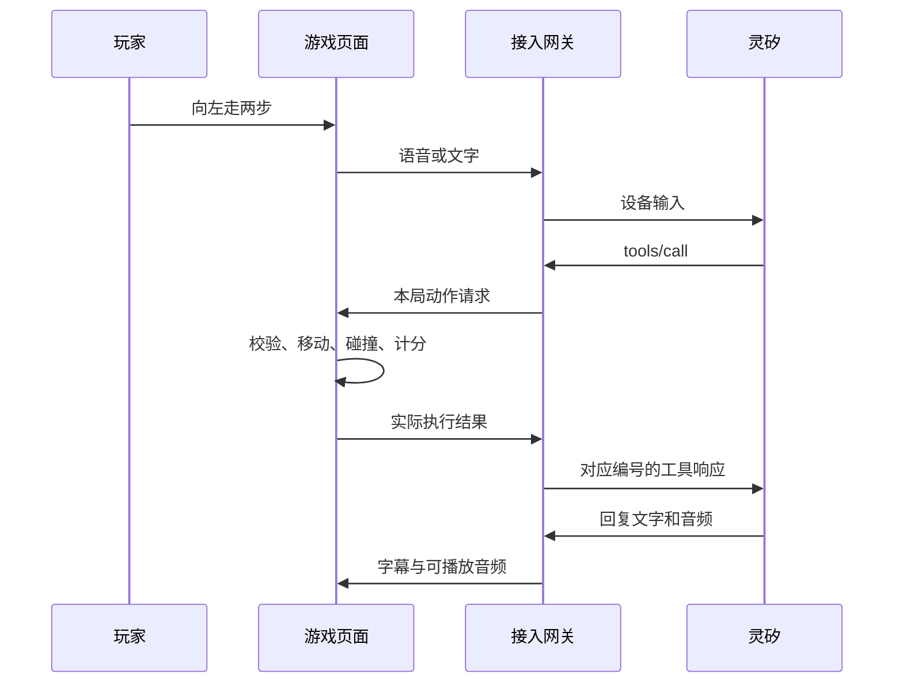

# 牛七七实现方案

本文回答游戏如何实现、如何对接灵矽，以及如何验证。面向方案评审和后续开发；状态为**待评审设计**，尚无游戏代码、实际账号联调或发布结果。规则以本轮对话确认为准，接口依据灵矽官方文档；核对日期为 2026-10-23。

## 1. 目标、范围与待评审选择

使用同一套 HTML（超文本标记语言）和 TypeScript（带类型检查的 JavaScript）实现浏览器应用，并供 iOS 的 WKWebView（系统网页容器）加载。应用启动后自动保持语音连接，VAD 按“有声音到无声音”切分聊天轮次；当玩家明确说想玩抓苹果时，灵矽调用开始游戏工具，页面切换为蒙眼抓苹果模式。界面适配 iPhone 12 Pro Max 竖屏，聊天和游戏都不显示操作按钮。

首版包含一个角色、一个场地、移动与转圈、苹果入袋、计分、疲惫反馈和聊天。暂不增加排行榜、账号系统、关卡、多人同场或复杂物理引擎；本地分数用于本局娱乐，不声称具有服务端防作弊保障。

以下是推荐实现选择，需随本方案评审确认，区别于用户已经确定的规则：

| 选择 | 推荐 | 原因 |
| --- | --- | --- |
| 牛的形象 | 双脚站立的圆润卡通牛 | 能自然做出伸手抓取、扶腿喘气和掏口袋动作 |
| 方向含义 | 以固定镜头为准，向前靠近镜头，向后远离镜头 | 玩家不用持续判断牛的朝向 |
| 抓取操作 | 移动至苹果附近自动抓取 | 减少再说一次“抓”的等待时间 |
| 疲惫 | 连续三个运动动作后出现约 5 秒疲惫表现，仍可移动 | 保留趣味，不与 1 分钟苹果寿命冲突；不暂停任何计时 |
| 首版语音 | 按住说话，松开等待回答 | 先验证稳定的采音、播放和打断，再评估自由对话 |

## 2. 已确认的游戏规则

本节是实现和验收的共同依据。

| 项目 | 规则 |
| --- | --- |
| 水果 | 统一为苹果 |
| 游戏时长 | 每局固定 3 分钟，到点结算，苹果过期不会提前结束游戏 |
| 初始苹果 | 开局同时随机出现 2 个 |
| 场内数量 | 可抓取的苹果最多 2 个；抓取后飞入口袋的表现不占场内名额 |
| 苹果寿命 | 每个苹果独立计算，默认 1 分钟，可在开局前配置，本局开始后固定 |
| 抓取 | 成功抓到后装入口袋，得 1 分 |
| 抓到后补位 | 抓取成立的时刻起 1 秒后，随机位置生成一个新苹果 |
| 过期后补位 | 苹果到期消失，从到期时刻起 1 秒后，随机位置生成一个新苹果 |
| 过期结果 | 不扣分，不减少生命，不结束本局 |
| 结算 | 第 3 分钟停止移动、抓取和补位，展示最终抓取数量 |

“抓取成立”是游戏判定的瞬间；此时移除可抓取实体并加分，随后播放入袋动画。苹果临近到期时被抓到，不会因入袋动画尚未播完而失效，也不会重复生成补位任务。

配置页面只暴露苹果寿命，接受有限的正数秒值；游戏时长、上限和补位间隔按上述规则固定。1 分钟是当前默认值；测试时可调整寿命比较，但默认值仍保持 1 分钟。

## 3. 页面和三维表现

采用 Vite（前端开发与构建工具）、原生 TypeScript 页面和 Three.js（浏览器三维渲染库），不额外引入大型界面框架。

页面由三个状态组成：

1. **准备**：显示居中的牛七七、连接状态和一个语音按钮。应用启动后连接灵矽，完成设备握手；按住说话时申请麦克风权限。权限被拒绝时提示重新授权，不回退到文字或动作按钮。
2. **进行**：顶部显示剩余时间和口袋苹果数；中央是蒙眼牛、场地和苹果；底部只提供按住说话。停止、移动、转圈和普通聊天均通过语音完成。布局使用动态视口和安全区域，场景与麦克风不超出手机可见区域。
3. **结算**：显示本局苹果数、角色结算动作和再来一局。点击再来一局才重新创建本局状态。

场景用固定镜头、平面地面和柔和阴影。三维素材按“可编辑源文件＋运行时 GLB（GL Transmission Format Binary，三维模型传输格式）”交付：先用可分组的低多边形卡通模型完成概念评审，再制作头、躯干、上臂、前臂、大腿、小腿、尾巴、眼罩和口袋的骨骼层级。项目当前没有已生成的三维模型、贴图或动作文件；这些是 M2 的实际开发交付物，不是现成依赖。

动作拆成三层，M2 必须制作并导出可由 Three.js（浏览器三维渲染库）播放的动作片段：

- 位移层：角色在地面的真实位置、朝向和场地边界。
- 身体层：待机、走路、转圈、抓取、扶腿喘气和恢复；走路时通过混合姿态保留疲惫感，不能一边扶腿一边让手穿过腿。
- 表情与音频层：眨眼、点头、简单嘴部开合、喘气和说话。初版嘴型跟随播放音量，不声称实现逐音素口型同步。

首版动作片段至少包括：`idle`（待机呼吸和眨眼）、`walk`（四方向共用的走路循环）、`spin`（原地转圈）、`reach`（伸手摸索）、`grab`（弯腰抓取）、`pocket`（苹果飞入口袋后的收纳动作）、`tired`（扶腿大喘气循环）、`recover`（恢复站直）、`talk`（说话点头和嘴部开合）、`blink`（眨眼叠加）和 `stop`（动作收尾）。动画控制器需要支持动作打断和从当前姿态平滑过渡；`walk` 的移动距离仍由 M1 的逻辑位置决定，动画不能自行推进游戏位置。

抓取时，苹果从当前位置飞向口袋，配合手部动作和得分提示；过期时缩小消失。身体是否疲惫由游戏规则决定，不能被灵矽的一条开心表情消息覆盖。

## 4. 架构与职责



网关使用 Node.js（服务端 JavaScript 运行环境）和 TypeScript，与页面同源部署；开发时由 Vite 转发连接。首版只需要一个接入服务，不需要消息队列或独立业务数据库。

| 部分 | 负责 | 不承担 |
| --- | --- | --- |
| 本地游戏规则 | 时间、位置、苹果生命周期、碰撞、计分、动作取消 | 依赖模型判断是否抓到苹果 |
| 三维渲染 | 把游戏状态表现为模型、动作、粒子和界面 | 修改分数或另起一套苹果倒计时 |
| 页面音频与对话 | 采音、播放、字幕、按键和文字提交 | 保存灵矽管理凭证 |
| 接入网关 | 设备注册绑定、鉴权、音频适配、工具路由和连接清理 | 自动替玩家寻找苹果、直接计算本地抓取结果 |
| 灵矽 | 语音识别、意图理解、选择工具、普通聊天和语音合成 | 决定游戏时钟、苹果位置或最终分数 |
| iOS 外壳 | 网页容器、麦克风权限、音频会话和生命周期通知 | 重写另一套游戏规则 |

### 4.1 为什么需要网关

浏览器原生 WebSocket（双向长连接协议）构造函数提供连接地址和子协议参数，不能直接指定任意握手请求头；灵矽设备连接要求 `Authorization`、`Device-Id`、`Client-Id` 和 `Protocol-Version`。因此浏览器连接自己的网关，由网关携带所需请求头连接灵矽；这也使 Web 和 iOS 使用同一条链路。[浏览器构造函数](https://developer.mozilla.org/en-US/docs/Web/API/WebSocket/WebSocket)、[灵矽设备连接协议](https://linx.qiniu.com/docs/xrobot/platform/websocket)。

## 5. 对接灵矽

### 5.1 控制台准备

创建“牛七七”智能体，配置中文音色、简短俏皮的角色介绍，以及支持工具调用的聊天模型。选择文档推荐的统一意图识别模式，再验证端侧工具能被调用。选择音色和模型后保存整页配置，并重新连接验证。首版不启用知识库和长期记忆，减少与三分钟游戏无关的配置。[智能体配置指南](https://linx.qiniu.com/docs/xrobot/guide/agent-config)。

角色要求建议为：你是牛七七，性格活泼，愿意听玩家指挥；普通问题简短回答；移动必须调用工具，执行结果未返回前不得声称完成；只根据返回结果说明抓到几个苹果；不能猜测苹果位置或自行导航。

### 5.2 设备身份、激活和绑定

网页不要求取得真实网卡地址。网关为浏览器会话分配并保留虚拟设备标识，使用规范的伪 MAC（Media Access Control，媒体访问控制地址）表示，并另外生成稳定的客户端标识。官方设备网关允许由硬件标识生成伪地址；纯浏览器会话生成的虚拟身份是否可接受，需要第一阶段用真实账号验证。[设备网关协议](https://linx.qiniu.com/docs/xrobot/platform/OTA)。

每个活动玩家独立使用虚拟设备和灵矽连接，不能让所有玩家共用同一个设备标识。浏览器通过服务端签发的会话凭据访问自己的连接，不能在消息中指定任意别人的设备或智能体。

接入顺序：

1. 网关调用 `POST https://xrobo.qiniuapi.com/v1/ota/`，携带一致的设备标识和客户端标识，取得激活信息。
2. 未绑定时，从响应取得激活码，通过控制台绑定，或由网关调用 `POST https://xrobo.qiniu.com/xiaozhi/device/bind/{agentId}/{deviceCode}`。管理接口使用的 API-KEY（接口访问密钥）仅保存在服务端。
3. 绑定成功后重新请求设备网关，取得 `websocket.url` 和 `websocket.token`；未绑定响应不能被当作已取得连接凭证。
4. 携带设备凭证建立加密连接，发送 `hello`，并声明 `features.mcp: true`。收到服务端 `hello` 后记录会话标识和实际音频参数。
5. 完成工具初始化和发现，才向页面报告连接就绪。

上述绑定接口已见于[设备接口文档](https://linx.qiniu.com/docs/xrobot/api/device)，但本项目尚未验证当前账号的密钥权限与配额。首轮联调可人工绑定一个设备以验证链路；公开多用户版本交付前必须验证自动绑定、身份隔离、设备容量和用量，不能将人工绑定单设备演示称为完整发布。

### 5.3 端侧工具初始化

MCP（Model Context Protocol，模型上下文协议，用于发现和调用工具）消息封装在灵矽的设备连接中。对灵矽而言，页面与网关整体构成设备端工具服务：网关响应协议初始化、报告工具描述；页面负责执行游戏动作并返回结果。[端侧工具协议](https://linx.qiniu.com/docs/xrobot/mcp/hardware-mcp)。

初始化顺序为：`hello` 能力声明 → 灵矽发起 `initialize` → 网关返回兼容能力 → 灵矽请求 `tools/list` → 网关返回工具列表 → 对话中收到 `tools/call`。

网关兼容实际协商的协议版本，不把文档示例中的版本号当作所有未来连接的固定值；没有请求编号的通知不回造请求响应。

### 5.4 自定义工具契约

首版只提供两个工具。下表和示例是本项目拟定契约，并非灵矽内置工具。

| 工具 | 参数 | 结果与边界 |
| --- | --- | --- |
| `self.niuqiqi.do_action` | `action`：`left`、`right`、`forward`、`backward`、`spin`、`stop`；移动时可带任意正整数 `steps`，默认 1 | 完成后返回实际步数、是否触边、途中抓取数、总分和疲惫状态；触边后提前结束，转圈和停止不接受多步 |
| `self.niuqiqi.get_status` | 无 | 返回准备/进行/结束、分数、剩余时间、当前动作和疲惫状态，不返回苹果坐标 |

工具描述明确“一步”的移动距离和方向语义，模型不直接写入位置。参数与本局状态由执行端再次检查，不能只靠模型遵守描述。用户说“左两步再向前一步”时，模型按顺序调用相应动作；不引入额外自动规划服务。

例如调用转圈，协议形式为：

```json
{
  "type": "mcp",
  "payload": {
    "jsonrpc": "2.0",
    "id": 17,
    "method": "tools/call",
    "params": {
      "name": "self.niuqiqi.do_action",
      "arguments": { "action": "spin" }
    }
  }
}
```

实际完成后返回，例如：

```json
{
  "type": "mcp",
  "payload": {
    "jsonrpc": "2.0",
    "id": 17,
    "result": {
      "content": [{
        "type": "text",
        "text": "{\"status\":\"completed\",\"action\":\"spin\",\"collected\":0,\"score\":4,\"remainingMs\":42100,\"fatigued\":true}"
      }],
      "isError": false
    }
  }
}
```

其中 JSON-RPC（使用 JSON 数据格式的远程过程调用协议）请求编号原样返回。入队只表示接受请求，不能立即返回 `completed`。动作被停止、超时或本局结束时，返回取消或失败结果。协议状态和错误信息使用英文，用户界面再映射成中文。



### 5.5 语音输入、播放与打断

页面使用 `getUserMedia`（浏览器请求麦克风的方法）获得音频，使用 AudioWorklet（浏览器音频处理线程机制）分帧、重采样并播放。公开页面使用 HTTPS（加密网页传输协议），首次由用户点击解锁音频并授权麦克风。[麦克风要求](https://developer.mozilla.org/en-US/docs/Web/API/MediaDevices/getUserMedia)、[音频处理机制](https://developer.mozilla.org/en-US/docs/Web/API/AudioWorklet)。

按住说话时发送 `listen.start`，使用手动监听模式；松开后送完剩余音频帧，再发 `listen.stop`。不能只收集录音文件，却没有按设备协议发送音频帧。

优先尝试协商 PCM（Pulse-Code Modulation，脉冲编码调制，未压缩音频）上传。灵矽文档一处说明支持 PCM 和 Opus（音频编码格式），另一处又说明输出采用 Opus，因此**上传与下行格式均以握手和实际数据验证为准**，不能假设同一编码配置双向都生效。

下行优先采用网关统一解码为 PCM，再交给页面播放，以保持 Web 与 iOS 一致；如果真实协商已得到 PCM，则直接转发。若需要 Opus 解码，第一阶段验证服务器解码组件能处理灵矽返回的原始帧，确认后只保留一条实现路径。浏览器 AudioDecoder（音频解码接口）目前仍标注兼容性有限，不作为首版跨端必需能力。[灵矽音频说明](https://linx.qiniu.com/docs/xrobot/platform/websocket)、[浏览器解码接口](https://developer.mozilla.org/en-US/docs/Web/API/AudioDecoder)。

说话中再次按住录音时，立即停止页面旧回复的播放、清空旧缓冲，并按灵矽协议发送 `abort`。旧音频后续即使到达也不能继续播放，重新一轮的播放边界需要实测确认。停止播报不等于停止牛的移动；停止按钮或新的停止动作单独取消移动。

通过 `stt`（Speech-to-Text，语音转文字）显示识别结果，通过 `tts.sentence_start` 显示实际回复文字，再播放对应音频。TTS（Text-to-Speech，文字转语音）消息和声音必须对应，不能把表示表情的 `llm.text` 字段当作整段回答。

### 5.6 文字输入和主动事件

官方文档包含 `listen.detect.text`、指定播报文字的 `text_response` 及动态音色示例，但不足以确认普通文字输入在当前服务上与语音具有完全相同的对话和工具调用行为。[设备协议](https://linx.qiniu.com/docs/xrobot/platform/websocket)、[带文本的切换示例](https://linx.qiniu.com/docs/xrobot/platform/agent-voice-switch)。

因此第一阶段必须验证：提交“向左走一步”能触发真实端侧工具，提交普通问题能生成回答和音频。失败时先确认平台支持的文字入口，再向用户说明证据和拟调整的接入方案。

不把每次苹果生成和倒计时都发送给灵矽。动作结果提供实际得分和状态；苹果入袋音效、过期音效和喘气声本地即时播放。固定疲惫台词如“你慢点说，我要炸了～”可使用本地配音，统一由一个播放控制器调度；普通聊天由灵矽生成。主动播报若使用 `text_response`，也先联调，不能把它当作已验证的任意后台事件注入接口。

用户开麦时停止台词播放；本局结束后优先展示本地结算和短配音。工具结果表明本地已经播报时，角色提示要求避免重复同一句，仍需听感验收。初版不因一个苹果过期就抢占玩家讲话或排队播报一长串吐槽。

## 6. 本地游戏规则实现

### 6.1 一个时钟和两个补位槽

游戏状态为 `ready → running → finished`。网关在连接就绪、玩家明确开始后签发本局编号、服务端开始时间和 3 分钟截止时间。页面根据服务端时间差建立本地计时基准，重连或恢复前台时重新校时；网关按同一个截止时刻停止接受本局工具、取消待执行请求并结束上游连接。网络等待、疲惫、隐藏页面或系统进入后台都不暂停、不重置截止时间。

苹果使用两个固定补位槽管理，每个槽只有两种状态：

- `active`：保存苹果唯一编号、位置、出现时间和到期时间。
- `waiting`：保存下一次生成的目标时间。

每局开始两个槽都进入 `active`。抓取或到期只允许把该槽转换一次，设定实际消失时刻加 1 秒的补位时间；补位后为苹果生成新编号。这比为每个表现对象各开一个定时器更容易保证数量上限和不重复补位。

每次更新先核对时间：已到本局截止时刻，先结算，不再处理加分；苹果已到期，先移除，不能再被碰撞抓取。未到期时才允许碰撞加分。到期和抓取同一瞬间发生时，到期优先。

调度使用目标时间计算，不依赖每秒减一或动画回调。当页面卡顿或恢复可见时，按当前时间推进苹果槽状态；不把错过的多个苹果一次性生成、不补记碰撞得分。未到本局截止时刻则继续剩余时间，已到截止时刻直接结算。苹果寿命调整只影响下一局。

### 6.2 移动、碰撞与随机位置

角色只在水平地面移动。一小步按固定距离和速度执行，多步拆成同样的小步；时长和距离先作为实现常量，在真实语音延迟和视觉试玩后定值，不增加用户配置面板。

采用地面圆形碰撞区域即可，无需刚体模拟。沿本次移动路径检查角色与苹果的距离，避免低帧率时跨过苹果却漏抓。抓取一经成立立即更改苹果状态和分数；转圈不产生平移，停止取消位移。

随机位置位于镜头可见、角色能走到的范围内，不能与另一颗苹果或牛当前的抓取区域重叠，避免开局自动得分。场地配置保证存在有效位置；随机尝试后可从有效候选点选取，不使用可能无限循环的重试。

默认 1 分钟包含玩家说话和实际网络处理时间。生成范围和移动速度只能减少路程，不足以保证所有语音请求都能赶上苹果；验收需要记录完整链路延迟，再由用户决定是否调整默认寿命。

### 6.3 动作队列、取消与跨局隔离

动作由页面唯一的控制器执行，按钮和灵矽工具调用同一个入口，不能各自实现一套位移。

首版推荐最多一个动作执行、一个请求等待。超过上限立即返回 `BUSY`，不积累长队列；`stop` 优先执行，取消当前动作和等待请求，并分别完成相关请求的取消响应。网关等待页面结果的上限必须短于实测确认的灵矽工具超时，不能默认平台支持任意长等待。

每个请求绑定本局编号和连接代次，按“连接代次＋请求编号”去重。重复调用返回既有执行状态或结果，不重复移动。页面断开、网关超时、本局结束后，旧请求不能继续执行；网络恢复不重播已发出的动作。

工具执行超时后若动作结果不确定，不自动重试；先取消对应动作并报告失败。新一局使用新的灵矽会话，旧会话和结果不能被重新标记为新一局。

### 6.4 疲惫与聊天并行

按推荐方案，每完成一步移动或一圈转圈计一次运动，完成第三次进入疲惫表现；取消和纯聊天不计入。疲惫阶段不限制运动、不暂停苹果或本局时钟，也不重复触发同一条喘气台词。

疲惫结束或正常阶段连续约 5 秒未完成运动后重新计数。计数与恢复时长属于待评审的表现规则，不改变第 2 节已确认的计分和计时规则。

## 7. 网关与页面的应用契约

这些是项目自有应用消息，不是新增灵矽协议。首版保持同源部署，避免为游戏另建完整账号体系。

| 消息方向 | 主要消息 | 职责 |
| --- | --- | --- |
| 页面 → 网关 | `round.start`、`speech.start`、音频帧、`speech.stop`、`chat.text`、`tool.result` | 请求开始、提交玩家输入、返回实际动作结果 |
| 网关 → 页面 | `connection.ready`、`round.started`、`tool.call`、`chat.transcript`、`audio.start`、音频帧、`audio.end`、`round.finished`、`connection.error` | 传递连接状态、截止时间、工具请求和回复 |

有本局归属的消息必须携带本局编号；音频流有本连接内的播放代次，网关去除已作废的数据。协议字面值、错误和日志使用英文；页面提示、开发文档和后续代码注释使用中文。

网关的灵矽管理密钥和设备凭证不下发给网页。页面断开时停止采音、取消待执行工具；本局仍按原截止时间结束，不赠送网络中断时间。设备重连若成功且尚未到期，继续原局；不成功则仍在截止时展示已取得的分数和连接提示。

## 8. 移动端、发布和运行

Web 采用移动端竖屏优先，适配安全区域、软键盘和触摸按钮。测试目标包含 iPhone Safari、iOS 网页容器和桌面浏览器；具体最低系统版本在第一阶段真机验证后确定，不能仅依据某个接口存在便声称支持所有版本。

iOS 外壳加载同源加密站点，配置麦克风用途说明和媒体采集权限处理；权限只授予游戏自己的来源。Apple 提供了网页媒体采集授权委托，但实际采音、播放和音频会话行为仍需真机检查。[Apple 媒体授权接口](https://developer.apple.com/documentation/webkit/wkuidelegate/webview(_:requestmediacapturepermissionfor:initiatedbyframe:type:decisionhandler:))。

进入后台或锁屏时停止采音和播放、取消动作队列、释放连接；本局截止时间继续流逝。回到前台重新校时：未到期可重新连接继续，已到期直接结算。新的连接不能恢复旧音频或旧工具请求。

三维渲染优先减少模型面数、材质数量和实时阴影开销，限制高像素密度设备的渲染尺寸；先以目标真机稳定运行完整三分钟为验收依据，不提前宣称固定帧率或电量表现。

交付形态为一份前端构建产物和一个网关服务，iOS 外壳复用同一个页面地址。开发时本机运行前端和网关，线上统一使用加密入口。真实密钥通过服务端环境配置注入；不写入前端构建变量、仓库或调试输出。

灵矽小时资源包按设备会话连接时长折算扣减，并非仅按实际说话时间计费。准备阶段在玩家选择连接时建立会话，避免长期空闲；本局到时关闭游戏连接，本地结算配音可继续播放，玩家主动选择继续聊天时再建立聊天连接。[资源包计时规则](https://linx.qiniu.com/docs/xrobot/billing/resource-usage-billing)。

## 9. 拟议代码组织

各目录的负责人、共享契约、独立验收和两人/多人分工见[模块划分与并行协作方案](parallel-development.md)。

各模块的具体执行步骤、交付物和验收用例见[模块执行计划与验收入口](module-plans/README.md)。

以下为开发时的职责边界示意，当前不创建这些代码文件：

```text
web/
  src/game/       游戏时钟、苹果槽、碰撞、计分和动作执行
  src/scene/      牛模型、关节动画、苹果入袋和场景
  src/audio/      麦克风、音频帧和统一播放
  src/linx/       页面连接、对话事件和工具请求适配
  src/ui/         准备、游戏界面、字幕和结算
server/
  src/device/     虚拟设备身份、激活、绑定和设备凭证
  src/linx/       灵矽连接、初始化、工具协议和音频适配
  src/session/    浏览器会话、本局截止时间和请求路由
ios/              后续薄外壳工程
docs/
  implementation-plan.md
```

工具名称、参数和页面网关消息在实现时维护一份共享契约；不为只有一个调用点的代码额外建通用框架。

## 10. 分阶段执行与验收

接入验证与本地玩法可以在共享契约确定后并行推进，角色、界面和音频也可按固定样例独立开发；最终整合仍需真实灵矽与目标设备验证。具体顺序见[并行协作方案](parallel-development.md)。

| 阶段 | 工作 | 验证项 |
| --- | --- | --- |
| 一：接入验证 | 真实账号配置、虚拟设备绑定、语音和文字输入、真实工具调用、音频解码 | 一句动作请求执行一次并返回；普通问题正常回答；工具结果编号匹配；目标 iPhone 能采音播放；记录音频格式和延迟 |
| 二：本地玩法 | 角色、场景、两个苹果槽、抓取入袋、3 分钟结算 | 不依赖云端先验证数量、寿命、补位、得分和截止时刻；视觉评审模型和动作 |
| 三：整合互动 | 灵矽工具接入动作控制器、疲惫与对话并行、停止和重连 | 语音、文字和按钮表现一致；疲惫不妨碍三分钟规则；旧请求不重复移动；工具返回真实得分 |
| 四：跨端交付 | 加密站点、独立多用户会话、iOS 外壳和真机验证 | 两个玩家互不串台；前后台不延长时间；拒绝权限可恢复；正常玩完三分钟并结算；凭证不进入页面资源和日志 |

阶段一没有通过的接口不能被后续阶段的本地模拟结果替代。人工绑定的单设备联调通过，也不能代替公开发布所需的自动绑定与多用户验证。

规则测试使用可控时间验证关键不变量，避免真实等待三分钟：开局两颗；抓取或过期后 999 毫秒无补位、1000 毫秒补一颗；抓取后不再被到期事件重复补位；同时消失独立补位；苹果到期不扣分；第 180 秒不再加分或生成；任意正整数步数在触边后结束；重复工具不重复移动；旧局请求不影响新局。

真实链路单独记录“松开录音到收到工具调用”“收到工具调用到开始运动”“动作完成到听到回复”，保留样本和测试环境，供判断 1 分钟苹果寿命的实际可玩性。不把模型等待时间误记为动画性能。

每阶段先自查职责边界、实现差异和验证证据，再交用户评审。未经明确开始开发授权不创建业务代码；开发完成不自动提交或发布。

## 11. 开发前需要的外部条件

- 通过评审确认第 1 节的形象、方向、抓取和疲惫选择。
- 可用的灵矽账号、牛七七智能体、支持工具调用的模型和中文音色，以及足够额度。
- 用于验证绑定权限的服务端访问密钥；联调时通过本地服务端配置提供，不需要粘贴到对话中。
- 一台用于实际验收的 iPhone；制作可安装 iOS 包时再确定签名和发布方式。

当前依据为官方文档，尚无真实账号调用、延迟数据、虚拟设备绑定结果或 iOS 真机运行结果。第一阶段必须解决普通文字入口、虚拟设备接受情况、管理密钥权限和实际音频编码；无法确认时报告具体证据和影响，再与用户确定调整，不能以猜测继续。
